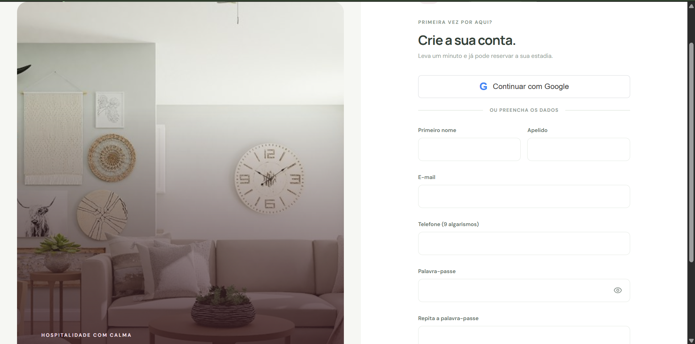
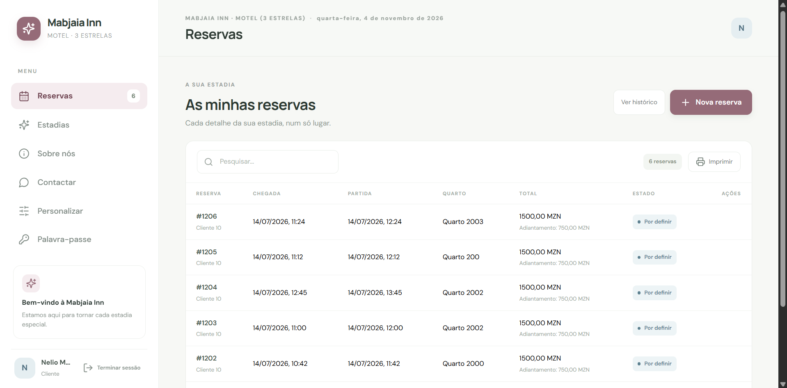
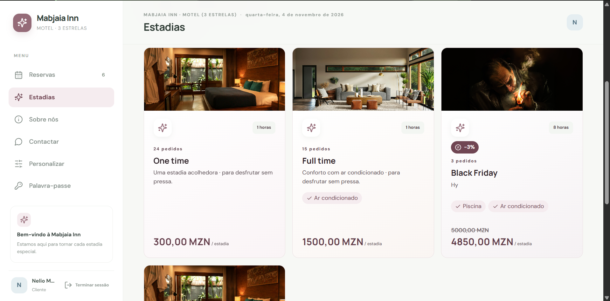
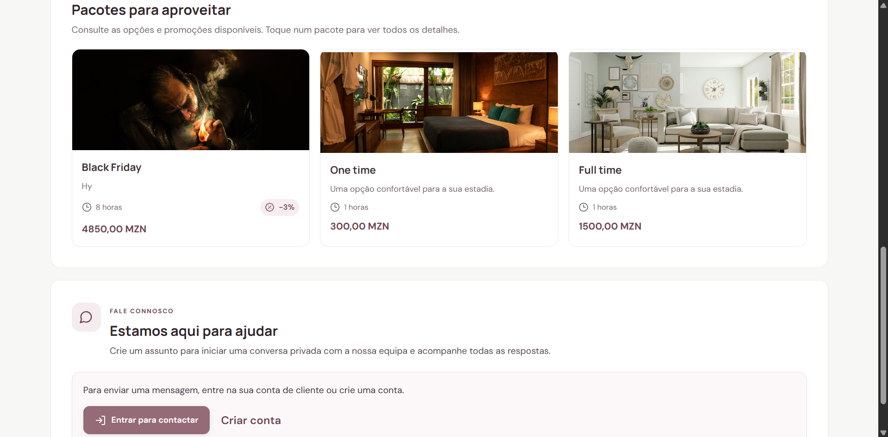

# 💻 Frontend - Management System

A modern web interface designed to provide a smooth, responsive, and intuitive experience for system management. The frontend was built using **React**, **Vite**, and styled with modern CSS/Tailwind solutions.

## 📸 Screenshots & Interface Walkthrough

Below are the screenshots of the application, located in the `frontend/images/` directory:

### Login Page - Overview


### User Form 


### Email Confirmation 


### User Bookings 


### Packages


### About Us



### 1. Main Dashboard

Overview of metrics, activity summary, and quick navigation.

### 2. Room & Accommodation Management

Interface for viewing and managing detailed listings of available accommodations and their status.

### 3. Room / Suite Details

Individual view and detailed management for a specific accommodation or package.

## 🛠️ Tech Stack

* **Core Library:** [React.js](https://react.dev/)
* **Build Tool:** [Vite](https://vitejs.dev/)
* **Routing:** [React Router DOM](https://reactrouter.com/)
* **HTTP Client:** [Axios](https://axios-http.com/)
* **Styling:** Tailwind CSS / CSS3

## ⚙️ Environment Variables

The project uses a `.env` file to configure the backend API connection.

Create a `.env` file in the root of the `frontend/` directory (or copy from the existing template):

```env
VITE_API_BASE_URL=/backend
```

> 📌 **Note:** The ignored `.env.local` selects the local Vite proxy (`/backend`); production builds use `.env.production` and the deployed API URL.

## 🚀 Getting Started

### Prerequisites

* **Node.js** (v18 or higher)
* **NPM** or **Yarn**

### Installation and Execution Steps:

1. **Start the backend:** In `guesthouse-fullstack-app (2)/guesthouse-fullstack-app`, create a PostgreSQL database named `mabjaiainn` in pgAdmin and enter your local PostgreSQL password in the ignored backend `.env.local`. Then run:
   ```powershell
   .\mvnw.cmd spring-boot:run
   ```

2. **Navigate to the frontend project directory:**
   ```bash
   cd "frontend (2)/frontend/mabjaia-inn-motel(guesthouse)-frontend"
   ```

3. **Install dependencies:**
   ```bash
   npm install
   ```

4. **Start the development server:**
   ```bash
   npm run dev
   ```

5. **Build for production:**
   ```bash
   npm run build
   ```
   *The optimized production files will be generated in the `dist/` directory.*

Open `http://localhost:5173`. Vite forwards `/backend` API requests to the local backend on port `8080`. `.env.local` files are ignored by Git; production settings remain in `.env.production` and the Render dashboard.

## 📁 Directory Structure

```text
frontend/
├── dist/                   # Production build output
├── images/                 # Screenshots and documentation assets
│   ├── Screenshot 2026-11-04 154151.png
│   ├── Screenshot 2026-11-04 154229.png
│   └── Screenshot 2026-11-04 154407.png
├── src/                    # Application source code
│   ├── assets/             # Static assets and images
│   ├── components/         # Reusable UI components
│   ├── pages/              # Views and page components
│   ├── services/           # API integration services
│   ├── App.jsx             # Root component
│   └── main.jsx            # Application entry point
├── .env                    # Environment variables
├── .gitignore              # Git ignore rules
├── index.html              # Main HTML entry point
├── package.json            # Node dependencies and scripts
└── vite.config.js          # Vite configuration
```
